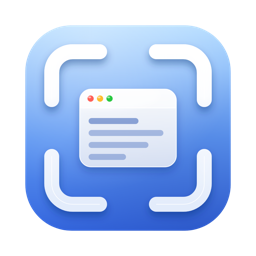

<p align="center">
  
</p>

<h1 align="center">Glimpse</h1>

<p align="center">
  方便、简洁、好用的 macOS 截图工具：截图、标注、贴图、提取文字，常驻菜单栏，数据不落盘。<br>
  A quiet menu-bar screenshot tool for macOS: capture, annotate, pin, extract text — all on-device, nothing stored.
</p>

<p align="center">
  <a href="https://github.com/AnglerDW/glimpse/releases/latest"></a>
  
  
  <a href="LICENSE"></a>
</p>

## 下载

- **正式版**：[GitHub Releases](https://github.com/AnglerDW/glimpse/releases/latest) → `Glimpse-<版本>.dmg`（或 `.zip`）
- 要求 macOS 14 Sonoma 及以上，Apple 芯片和 Intel 都支持
- 介绍页：<https://anglerdw.github.io/glimpse/>

### 安装与第一次打开

1. 打开 dmg，把 Glimpse 拖到「应用程序」。
2. 第一次打开时 macOS 会提示「无法验证开发者」：到 **系统设置 → 隐私与安全性**，在页面底部点「仍要打开」（或在 Finder 里右键 Glimpse → 打开）。原因见下面「关于签名」。
3. Glimpse 会弹出引导窗口，点「去授权」，在 **系统设置 → 隐私与安全性 → 屏幕录制** 里打开 Glimpse 的开关，然后按提示重新启动 Glimpse。截图工具都需要这一步，Glimpse 只在你按下快捷键时读取屏幕。

## 功能

| 功能 | 说明 |
|---|---|
| 截图 | 区域截图、窗口截图（悬停自动高亮，单击选中）、整屏截图（按空格）；放大镜带十字线、像素坐标和取色 |
| 标注 | 矩形、椭圆、箭头、画笔、文字、马赛克、序号；三档粗细、六种颜色；撤销 / 重做 |
| 输出 | 复制到剪贴板、保存 PNG（默认「下载」，可改） |
| 贴图 | 把截图原位钉在屏幕上（置顶浮窗），可拖动、调透明度、双击关闭 |
| 提取文字 | 本地离线识别（Vision 框架），识别语言跟随系统语言（始终含英文，简繁中文同时开）；结果自动复制，可编辑 |
| 取色 | 截图时按 C 复制十六进制色值，⇧C 复制 RGB |
| 其他 | 开机自动启动（可关）、跟随系统日夜间、界面跟随系统语言（11 种，其余语言回退英文，可在设置里改界面语言）、可选界面强调色、自定义快捷键、所有提示用应用内 HUD（不申请通知权限） |

<!-- 截图（待补）：docs/media/ 下放 capture.png、annotate.png、pin.png、ocr.png、settings.png -->

## 快捷键

| 场景 | 按键 |
|---|---|
| 截图（全局） | ⇧⌘A |
| 提取文字（全局） | ⌃O |
| 选区阶段 | 空格：整屏 · ↩ / ⌘C：复制当前高亮 · ⌘S：保存 · C / ⇧C：复制颜色 · Esc：退出 |
| 编辑阶段 | R 矩形 · O 椭圆 · A 箭头 · P 画笔 · T 文字 · M 马赛克 · N 序号 · ⌘Z / ⇧⌘Z 撤销重做 · ↩ / ⌘C / 双击：完成并复制 · ⌘S：保存 · 右键：重新选区 · Esc：取消工具 / 退出 |
| 贴图 | 拖动移动 · 双击关闭 · 右键：复制 / 保存 / 透明度 / 关闭 |
| 提取文字面板 | Esc / ⌘W 关闭 |

全局快捷键和 iShot 的默认值一致，可在「设置」里改。升级后「提取文字」默认是 ⌃O；之前在设置里手动清空过的不受影响。⌃O 会占用其他应用里的 Control-O（如文本框里 Emacs 风格的换行），介意可在设置里换一个。

## 隐私

Glimpse 是一个完全离线的本机工具，不联网、不收集任何数据。

**会访问什么**

- **屏幕录制权限**：截图必需。只在你按下快捷键或点菜单「截图 / 提取文字」时读取一次当前画面；平时不录屏。为了判断鼠标下是哪个窗口，会读系统窗口列表的位置、层级和进程号，**不读窗口标题**。
- **剪贴板**：只往里写（截图、提取出的文字、颜色值），不读取。
- **保存目录**：默认「下载」，可改；只有你点「保存」或 ⌘S 时才写一张 PNG，从不覆盖已有文件。系统会在第一次写入「下载 / 桌面 / 文稿」时再问一次文件夹权限。
- **登录项**：首次引导时推荐开启「开机自动启动」，在你点「去授权」时才真正注册；随时可在设置或「系统设置 → 通用 → 登录项」关闭。
- **全局快捷键**：走系统 `RegisterEventHotKey`，只收到你设的那一两个组合键；不装键盘监听，不用辅助功能权限。

**不会做什么**

- 不发网络请求，没有统计、崩溃上报或第三方 SDK；文字识别用 macOS 自带的 Vision，在本机完成。
- 不保存截图历史，没有缓存文件；冻结画面、贴图、识别出的文字只在内存里，关掉就释放。
- 不请求通知、相机、麦克风、定位权限。
- 系统日志里只记「保存成功 / 失败」这类状态，不记文字、颜色值或文件路径。

**数据放在哪里**：硬盘上只有你主动保存的 PNG，和 `~/Library/Preferences/com.anglerdw.glimpse.plist` 里几百字节的设置项（快捷键、保存目录、强调色、标注样式）。应用未启用沙盒，已启用 Hardened Runtime。代码开源，可以自己看、自己编。

## 关于签名

Release 包目前是 **ad-hoc 签名**（没有 Apple Developer ID），所以第一次打开要在「隐私与安全性」里手动放行，而且重新安装后要重新授权屏幕录制。要去掉这一步，需要一个 Apple Developer Program 账号（99 美元 / 年）签发 Developer ID 证书并做公证；`scripts/release.sh` 已经支持：有证书时自动用它签名，设置 `NOTARY_PROFILE` 就会公证并加盖票据。

## 从源码构建

需要 Xcode 26（macOS 14 SDK 即可）、[XcodeGen](https://github.com/yonaskolb/XcodeGen)（`brew install xcodegen`）。

```bash
scripts/run.sh                   # 构建、签名、重启开发版（一律用它，不要用 Xcode ⌘R，见下）
scripts/build.sh                 # 只构建并签名，最后一行输出 .app 路径
cd Core && swift test            # 业务逻辑单元测试
scripts/render-app-icon.sh       # 从 App/Resources/AppIcon/AppIcon.svg 重新渲染 App 图标（需要 Chrome）
scripts/i18n/generate_xcstrings.py  # 从 scripts/i18n/strings.json 生成三份 String Catalog（改文案只改这张表）
scripts/release.sh               # 出 dist/Glimpse-<版本>.dmg / .zip（Release、universal、hardened runtime）
```

- `Core/`：GlimpseCore Swift 包（纯逻辑，有测试）；`App/`：AppKit 外壳；`project.yml`：XcodeGen 工程描述。
- `App/Info.plist` 和 `Glimpse.xcodeproj` 由 XcodeGen 生成，不要手改，改 `project.yml`。
- **不要用 Xcode ⌘R 运行**：Xcode 每次构建签名都不一样，macOS 会把它当成新应用，「屏幕录制」权限随之失效；脚本固定用同一张证书签名，权限才能保住。钥匙串里有多张 Apple Development 证书时用 `GLIMPSE_SIGN_ID` 指定。
- macOS 26 的液态玻璃图标：用 Xcode 自带的 Icon Composer 打开 `App/Resources/AppIcon/layers/`（说明见该目录的 README），导出 `Glimpse.icon` 到 `App/Resources/`。

设计文档：`docs/superpowers/specs/2026-11-04-glimpse-design.md`。

## English

Glimpse is a menu-bar screenshot tool for macOS 14+ (Apple silicon and Intel): area / window / full-screen capture with a magnifier and color picker, annotations (rectangle, ellipse, arrow, pen, text, mosaic, counter), copy or save as PNG, pin captures on top of everything, and on-device text extraction (Vision; recognition languages follow your system languages, always including English). The UI follows your system language (11 languages; English for everything else).

- **Download**: [latest release](https://github.com/AnglerDW/glimpse/releases/latest) (`.dmg` or `.zip`). The build is ad-hoc signed for now, so on first launch go to *System Settings → Privacy & Security* and click *Open Anyway*, then grant *Screen Recording* when the onboarding window asks and relaunch.
- **Shortcuts**: ⇧⌘A capture, ⌃O extract text (both configurable). In the overlay: Space full screen, ↩ / ⌘C copy, ⌘S save, C / ⇧C copy color, R O A P T M N tools, Esc.
- **Privacy**: no network access at all, no analytics, nothing written to disk except the PNGs you save and a few hundred bytes of settings; global hotkeys use `RegisterEventHotKey`, never a key logger; window titles are never read.
- **Build**: Xcode 26 + [XcodeGen](https://github.com/yonaskolb/XcodeGen); `scripts/build.sh` (dev), `scripts/release.sh` (universal dmg/zip, hardened runtime, Developer ID + notarization when a certificate is available), `cd Core && swift test`.

## 许可

[MIT](LICENSE) © 2026 AnglerDW
